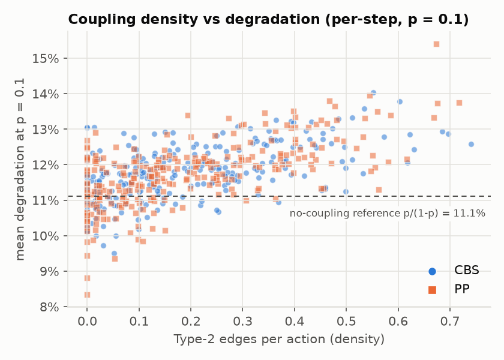

# MAPF-CBS: Conflict-Based Search, and how optimal plans hold up under execution delays

This repository has two parts.

* **Part A, a re-implementation.** Conflict-Based Search (CBS; Sharon et al. 2015) and
  prioritized planning (PP) with space-time A*, written from scratch in Python and benchmarked
  on Moving AI grids. These are known algorithms; nothing in Part A is new.
* **Part B, the original contribution.** A delay-robustness study. Plans from both solvers are
  executed with an Action Dependency Graph (ADG; Hönig et al. 2019) while robots suffer random
  delays. The study measures how much each kind of plan slows down and whether cross-robot
  coupling predicts the slowdown.

Every number and figure below is produced by scripts in this repository from the CSV files in
`results/`. The tables are pasted in by `scripts/update_readme.py`, not typed.

<!-- BEGIN KEY FINDINGS -->
<!-- END KEY FINDINGS -->

---

## 1. Problem

**Multi-Agent Path Finding (MAPF).** A 4-connected grid with blocked cells and k agents, each
with a start and a goal cell. Time is discrete. In each step every agent moves to a neighbouring
free cell or waits, at cost 1. A solution gives every agent a path from its start to its goal.
An agent that has arrived stays on its goal.

**Conflicts.** Following Stern et al. (2019), this project forbids:

| conflict | meaning |
|---|---|
| vertex | two agents in the same cell at the same time |
| swap | two agents exchange cells in one step |
| following | an agent enters a cell in the same step another agent leaves it |

Forbidding following also forbids cycle (rotation) conflicts. This is the conflict model used by
the ADG-execution literature: Ma et al. 2017 (MAPF-DP), the 1-robust plans of Atzmon et al. 2020,
and Zahrádka et al. 2025. Zahrádka et al. note that following moves make ADG execution slower
than planned, and rotations make the ADG cyclic, which deadlocks. Under this model, executing a
plan with no delays reproduces it exactly (minus unneeded waits), so Part B measures delays
rather than artefacts of the conflict model. The trade-off is that Part A solves the
no-following variant of MAPF, which is a little harder than the plain vertex + swap variant.

**Objective.** Sum of costs (SOC): the sum over agents of the time each agent reaches its goal
for the last time, ignoring trailing waits (Stern et al. 2019). Makespan is the largest such time.

## 2. Algorithms (Part A, re-implementations)

**Space-time A\*** (`mapf/astar.py`). Searches over states (cell, t), using an exact
backward-BFS distance heuristic cached per (map, goal). It respects vertex constraints
"not at c at t" and edge constraints "not u→v arriving at t". An agent may only finish at a time
after the last constraint on its goal. Two details keep the search finite and fast: the horizon
is capped at |free cells| + the latest constraint time, and states after the latest constraint
are deduplicated by cell.

**Prioritized planning** (`mapf/prioritized.py`). Plain PP, with no restarts:

```
reservations = {}
for agent i in scenario order:
    path_i = space_time_astar(i, constraints from reservations)
    if no path: return FAILURE
    reserve path_i: (cell, t-1), (cell, t), (cell, t+1) for every step   # no vertex/following conflicts
    reserve goal_i forever from arrival-1
```

**CBS** (`mapf/cbs.py`). The basic version, with no bypass, conflict prioritization, disjoint
splitting or high-level heuristics:

```
root.paths = shortest path of every agent;  OPEN = {root}   # ordered by (SOC, #conflicts, insertion)
loop:
    N = pop(OPEN)
    C = earliest conflict in N.paths
    if none: return N.paths                                   # optimal
    vertex (i, j, c, t):           children add  i: not (c,t)   |  j: not (c,t)
    following (i enters c at t, j left c at t-1):
                                   children add  i: not (c,t)   |  j: not (c,t-1)
    for each child: replan only the constrained agent; drop the child if it has no path
```

The following split is sound: no solution can have both i at c at t and j at c at t-1, so CBS
remains optimal for this model. The tests compare CBS against a brute-force joint-state Dijkstra
on 4×4 maps with 2–3 agents under both conflict models (`tests/test_cbs.py`).

**Independent validator** (`mapf/validator.py`). It imports no solver code. It checks starts,
goals, legal moves, and vertex, swap and following conflicts after padding the paths. A solution
counts as a success only if it passes.

## 3. Delay study (Part B, original)

**Motivation.** Real robots are not synchronised: they slip, slow down and stall. An ADG keeps
execution collision-free under any finite delays by turning the plan's timing into ordering
rules. But a delayed robot then holds up every robot that was planned to use a cell after it.
SOC-optimal plans are packed tightly, so they may hand more of these dependencies to other
robots than looser PP plans do.

**Research question.** Under ADG execution with random delays, do SOC-optimal CBS plans lose
more execution efficiency than PP plans? Does the number of cross-robot dependencies in a plan
predict that loss?

* **H1:** on instances both algorithms solve, CBS plans degrade more under delays than PP plans.
* **H2:** across all plans, degradation increases with cross-agent dependency (Type-2) density.

A null or reversed result is a valid finding; the tables report whatever the data shows.

**ADG** (`mapf/adg.py`, after Hönig et al. 2019, Algorithm 1). Each path becomes move actions
(s, g, t); waits are dropped.

* **Type-1 edges** chain a robot's own actions.
* **Type-2 edges** run (i,k) → (j,l) for the *first* action l of robot j with
  s(i,k) = g(j,l) and t(i,k) ≤ t(j,l): j may enter the cell only after i has left it.

Coupling metrics: Type-2 edge count, **density** = Type-2 edges per action, and the number of
coupled robots. Every benchmark solution's ADG is checked acyclic (Kahn's algorithm).

**Simulator** (`mapf/execution.py`). Discrete time; each move takes one step. A robot may start
its next action only once all its ADG predecessors have completed. A ready robot is delayed:

* **per-step model (primary):** frozen for that step with probability p ∈ {0, 0.05, 0.1, 0.2, 0.3};
* **burst model (secondary):** frozen for D = 5 steps with probability p.

Executed cost of a robot = the time its last action completes; executed SOC = the sum. A deadlock
guard raises an error if no robot is ready for 1,000 steps; it never fired. **Execution
checker:** every trace is checked for vertex conflicts, swaps and non-unit moves before it is
counted.

**Metric.** Degradation(p) = executed SOC at p / executed SOC at p = 0, minus 1, averaged over
R = 30 seeded trials per (solution, p, model). The baseline is the p = 0 execution rather than
the planned SOC, so dropped waits don't distort the comparison. Each trial's seed is
sha256(map|scen|k|algorithm|p|trial) and is recorded in the CSV.

**Statistics** (`experiments/analyze_delays.py`).

* **H1:** paired Wilcoxon signed-rank test (two-sided) on per-instance mean degradation, CBS
  minus PP, for each p. Reported on all pairs and on pairs where the two plans differ, because
  on identical plans the difference is pure noise.
* **H2:** Spearman correlation between density and degradation, overall and per algorithm,
  together with the correlation with k and the rank partial correlation controlling for k. The
  partial correlation shows whether density predicts anything beyond crowding.

## 4. How to run

```bash
pip install -r requirements.txt            # Python 3.12+ for the pinned versions (code runs on 3.10+)
python scripts/download_benchmarks.py      # Moving AI maps + random scenarios -> data/
python -m pytest -q                        # unit + integration tests
python experiments/run_benchmark.py --pilot  # optional: time scenario 1 first
python experiments/run_benchmark.py        # Step 7 -> results/benchmark.csv, results/solutions/
python experiments/analyze.py              # Step 8 -> results/summary.md, plots
python experiments/run_delays.py           # Step 10 -> results/delays.csv
python experiments/analyze_delays.py       # Step 10 -> results/delay_summary.md, plots
python experiments/report.py               # headline numbers -> results/report.md
python scripts/update_readme.py            # paste the generated tables into this README
```

`scripts/reproduce.sh` runs the whole pipeline. To check a fresh run against the committed
results, run `python scripts/check_reproduction.py --fresh-dir <dir>`. SOC values and every
delay row must match exactly. Runtimes, and so which borderline instances finish inside the
time limit, depend on the machine.

## 5. Results

### Part A: benchmark


<!-- BEGIN results/summary.md -->
<!-- END results/summary.md -->

### Part B: delay robustness




<!-- BEGIN results/delay_summary.md -->
<!-- END results/delay_summary.md -->

## 6. Related work

Summary of `notes/related_work.md`:

* **Hönig et al. (2019)** introduced the ADG for robust, persistent execution of MAPF plans on
  warehouse robots. Following conflicts appear as dependencies, and rotation cycles as ADG cycles.
* **Atzmon et al. (2020)** define k-robust plans and compare robust execution policies under
  delay probabilities. Using k-robust plans reduces repairs during execution.
* **Zahrádka et al. (2025)** monitor ADG execution, estimate completion times through the ADG,
  and decide when replanning pays off. They require plans without following conflicts.
* **Ma et al. (2017)** plan for delay probabilities (MAPF-DP).

None of the papers read compares SOC-optimal CBS plans with PP plans under ADG execution with
random delays, so H1 is treated as an open empirical question. The "NSF-hosted study comparing
MAPF models under ADG execution" named in the project brief was not checked, so this framing
must be revisited if it addresses H1.

## 7. Limitations

* **Pure Python.** Basic CBS times out beyond a few dozen agents (see the tables), and some
  small instances also time out when many conflicts interact. The delay study therefore covers
  only instances CBS can solve, which skews towards lower k.
* **No CBS enhancements** (bypass, prioritizing conflicts, disjoint splitting, symmetry
  reasoning, heuristics).
* **Plain PP with one fixed priority order** (scenario order). Under the no-following model, a
  higher-priority robot that enters a lower-priority robot's start cell at t ≤ 1 makes the
  instance unsolvable for PP (counted as `start_blocked`). Revised prioritized planning (Čáp et
  al. 2015), which avoids lower-priority start cells, would remove most of these failures.
* **Unit-time moves**, with no rotations, acceleration or kinematics; a cell-sized safety
  distance.
* **Synthetic delay models** (independent per-step or fixed-length bursts), not measured robot
  behaviour.
* Runtimes come from a laptop CPU with mixed performance and efficiency cores and 8 parallel
  workers, so they are noisy near the time limit.

## 8. Robot Conga

This planning layer would sit above a path-following controller. That controller's real
tracking errors and stalls are the kind of delays this study models.

## 9. References

* G. Sharon, R. Stern, A. Felner, N. R. Sturtevant. *Conflict-based search for optimal
  multi-agent pathfinding.* Artificial Intelligence 219:40–66, 2015.
* R. Stern et al. *Multi-Agent Pathfinding: Definitions, Variants, and Benchmarks.* SoCS 2019.
* W. Hönig, S. Kiesel, A. Tinka, J. W. Durham, N. Ayanian. *Persistent and Robust Execution of
  MAPF Schedules in Warehouses.* IEEE RA-L 4(2):1125–1131, 2019.
* D. Atzmon, R. Stern, A. Felner, G. Wagner, R. Barták, N.-F. Zhou. *Robust Multi-Agent Path
  Finding and Executing.* JAIR 67:549–579, 2020.
* D. Zahrádka, D. Muzikářová, D. Woller, M. Kulich, J. Švancara, R. Barták. *A Holistic
  Architecture for Monitoring and Optimization of Robust Multi-Agent Path Finding Plan
  Execution.* arXiv:2509.10284, 2025.
* H. Ma, T. K. S. Kumar, S. Koenig. *Multi-Agent Path Finding with Delay Probabilities.*
  AAAI 2017.
* M. Čáp, P. Novák, A. Kleiner, M. Selecký. *Prioritized Planning Algorithms for Trajectory
  Coordination of Multiple Mobile Robots.* IEEE T-ASE 12(3), 2015.
* N. Sturtevant. Moving AI Lab MAPF benchmarks. https://movingai.com/benchmarks/mapf/
