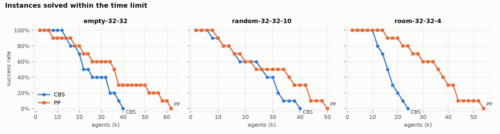
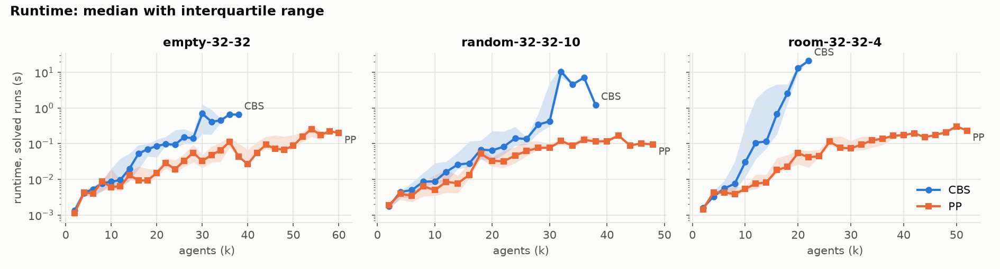
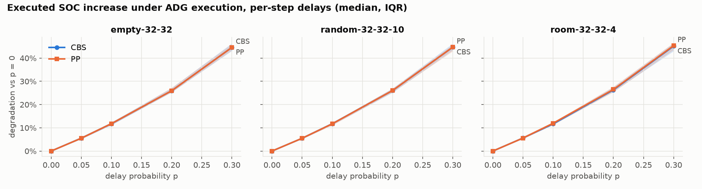
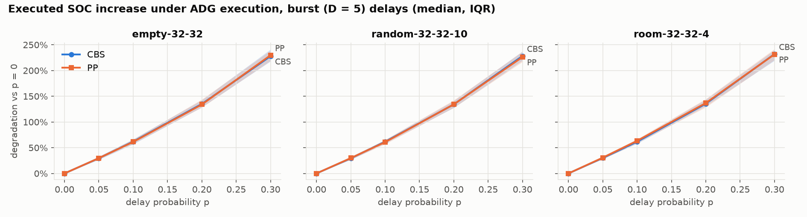

# MAPF-CBS: Conflict-Based Search, and how optimal plans hold up under execution delays

This repository has two parts.

* **Part A, a re-implementation.** Conflict-Based Search (CBS; Sharon et al. 2015) and
  prioritized planning (PP) with space-time A*, written from scratch in Python and benchmarked
  on Moving AI grids. These are known algorithms; nothing in Part A is new.
* **Part B, the original contribution.** A delay-robustness study. Plans from both solvers are
  executed with an Action Dependency Graph (ADG; Hönig et al. 2019) while robots suffer random
  delays. The study measures how much each kind of plan slows down and whether cross-robot
  coupling predicts the slowdown.

Every number and figure below is produced by scripts in this repository from the CSV files in
`results/`. The tables are pasted in by `scripts/update_readme.py`, not typed.

## Key findings

The numbers quoted here are taken from the generated files `results/report.md`,
`results/summary.md` and `results/delay_summary.md`, which are pasted below.

1. **Part A works, and every solution was checked.** 1,350 benchmark runs on three Moving AI
   maps produced no invalid solution. CBS never returned a higher SOC than PP. CBS solves at
   least half the instances up to k = 24 (empty), 26 (random) and 16 (room); plain PP reaches
   36, 34 and 36. Where both succeed, PP's plans cost on average 2.3% more than optimal
   (at most 16.3%).
2. **Plain PP's failures are almost all start-cell blocking.** 348 of its 359 failures happen
   because a higher-priority robot enters a lower-priority robot's start cell at t ≤ 1. That is
   unavoidable under the no-following model, so plain PP is a weak baseline here.
3. **Without delays, ADG execution reproduces every plan exactly**, because the planners forbid
   following conflicts.
4. **H1 is not supported.** SOC-optimal CBS plans do *not* degrade more than PP plans:
   * Under per-step delays the paired differences stay below 0.2 percentage points, and none
     is significant after Holm correction.
   * Under burst delays, on instances where the two plans differ, CBS plans degrade slightly
     *less* (median 0.6–1.5 points; Holm p ≤ 0.04 at every p).
   * PP plans contain more waiting for other robots and are a little more coupled (Type-2
     density 0.196 vs 0.187).
5. **H2 is supported.** Type-2 density correlates with degradation (Spearman ρ = 0.55–0.73
   per-step, 0.77–0.82 burst). It still predicts degradation after controlling for the number
   of agents (partial ρ = 0.30–0.43 per-step, 0.47–0.56 burst), so it is not only a proxy for
   crowding.
6. **Most of the slowdown is each robot's own delay.** At p = 0.1 per-step, an uncoupled robot
   loses p/(1−p) = 11.1% and the plans lose 11.7–11.8%. At p = 0.1, coupling adds under one
   percentage point with per-step delays and about 6–7 points with bursts. At p = 0.3 the
   per-step excess grows to 2–3 points.

**Caveat:** the delay study covers only the 268 instances CBS could solve (mean k = 12). The
tight-coupling regime of large k is out of reach for pure-Python CBS.

<!-- BEGIN results/report.md -->
Generated by `experiments/report.py` from the result CSVs. Do not edit by hand.

#### Benchmark

- Maps: empty-32-32, random-32-32-10, room-32-32-4 (Moving AI, random scenarios 1,2,3,4,5,6,7,8,9,10)
- Runs: 1350 (CBS and PP, k = 2, 4, ...; 60.0 s limit); benchmark wall time 30 min on 8 workers; delay study wall time 30 s
- Invalid solutions: 0 (every success passed the validator)

Success rates are over the k values both algorithms were run at (CBS's range), so they compare like with like.

| map | max k at >= 50% success, CBS | same, PP | k range compared | CBS success | PP success |
|---|---:|---:|---|---:|---:|
| empty-32-32 | 24 | 36 | 2-40 | 61.5% | 73.0% |
| random-32-32-10 | 26 | 34 | 2-40 | 56.5% | 65.5% |
| room-32-32-4 | 16 | 36 | 2-24 | 63.3% | 94.2% |

- On the 268 instances both solve, PP SOC / CBS SOC: mean 1.0228, max 1.1632; PP is suboptimal on 54.9% of them.

#### Delay study

- Paired instances: 268; 30 trials per (solution, p, model); 160800 simulated executions, all passing the execution checker.

##### H1, per-step delays (CBS minus PP degradation; Wilcoxon signed-rank)

| p | pairs (plans differ) | median diff | share CBS worse | p-value | Holm p | pairs (all) | median diff | Holm p |
|---:|---:|---:|---:|---:|---:|---:|---:|---:|
| 0.05 | 170 | -0.0007 | 45.9% | 0.027 | 0.109 | 268 | +0.0002 | 0.673 |
| 0.1 | 170 | -0.0006 | 47.1% | 0.437 | 0.437 | 268 | -0.0003 | 1.000 |
| 0.2 | 170 | -0.0016 | 42.9% | 0.038 | 0.113 | 268 | -0.0003 | 1.000 |
| 0.3 | 170 | -0.0018 | 41.2% | 0.137 | 0.273 | 268 | -0.0010 | 1.000 |

##### H2, per-step delays (Spearman over all solutions)

| p | rho(density, deg) | p-value | rho(k, deg) | rho(density, deg \| k) | p-value |
|---:|---:|---:|---:|---:|---:|
| 0.05 | +0.546 | 6.56e-43 | +0.493 | +0.296 | 2.99e-12 |
| 0.1 | +0.579 | 3.12e-49 | +0.541 | +0.297 | 2.21e-12 |
| 0.2 | +0.682 | 1.74e-74 | +0.607 | +0.418 | 4.98e-24 |
| 0.3 | +0.728 | 9.66e-90 | +0.682 | +0.428 | 3.32e-25 |

##### H1, burst delays (CBS minus PP degradation; Wilcoxon signed-rank)

| p | pairs (plans differ) | median diff | share CBS worse | p-value | Holm p | pairs (all) | median diff | Holm p |
|---:|---:|---:|---:|---:|---:|---:|---:|---:|
| 0.05 | 170 | -0.0056 | 41.8% | 0.001 | 0.004 | 268 | -0.0022 | 0.113 |
| 0.1 | 170 | -0.0066 | 42.9% | 0.016 | 0.038 | 268 | -0.0034 | 0.879 |
| 0.2 | 170 | -0.0082 | 41.2% | 0.013 | 0.038 | 268 | -0.0035 | 0.879 |
| 0.3 | 170 | -0.0154 | 40.6% | 0.021 | 0.038 | 268 | -0.0119 | 0.879 |

##### H2, burst delays (Spearman over all solutions)

| p | rho(density, deg) | p-value | rho(k, deg) | rho(density, deg \| k) | p-value |
|---:|---:|---:|---:|---:|---:|
| 0.05 | +0.766 | 1.11e-104 | +0.721 | +0.469 | 1.29e-30 |
| 0.1 | +0.781 | 1.87e-111 | +0.749 | +0.474 | 2.19e-31 |
| 0.2 | +0.820 | 1.77e-131 | +0.756 | +0.561 | 1.10e-45 |
| 0.3 | +0.822 | 6.94e-133 | +0.780 | +0.545 | 9.49e-43 |
<!-- END results/report.md -->

---

## 1. Problem

**Multi-Agent Path Finding (MAPF).** A 4-connected grid with blocked cells and k agents, each
with a start and a goal cell. Time is discrete. In each step every agent moves to a neighbouring
free cell or waits, at cost 1. A solution gives every agent a path from its start to its goal.
An agent that has arrived stays on its goal.

**Conflicts.** Following Stern et al. (2019), this project forbids:

| conflict | meaning |
|---|---|
| vertex | two agents in the same cell at the same time |
| swap | two agents exchange cells in one step |
| following | an agent enters a cell in the same step another agent leaves it |

Forbidding following also forbids cycle (rotation) conflicts. This is the conflict model used by
the ADG-execution literature: Ma et al. 2017 (MAPF-DP), the 1-robust plans of Atzmon et al. 2020,
and Zahrádka et al. 2025. Zahrádka et al. note that following moves make ADG execution slower
than planned, and rotations make the ADG cyclic, which deadlocks. Under this model, executing a
plan with no delays reproduces it exactly (minus unneeded waits), so Part B measures delays
rather than artefacts of the conflict model. The trade-off is that Part A solves the
no-following variant of MAPF, which is a little harder than the plain vertex + swap variant.

**Objective.** Sum of costs (SOC): the sum over agents of the time each agent reaches its goal
for the last time, ignoring trailing waits (Stern et al. 2019). Makespan is the largest such time.

## 2. Algorithms (Part A, re-implementations)

**Space-time A\*** (`mapf/astar.py`). Searches over states (cell, t), using an exact
backward-BFS distance heuristic cached per (map, goal). It respects vertex constraints
"not at c at t" and edge constraints "not u→v arriving at t". An agent may only finish at a time
after the last constraint on its goal. Two details keep the search finite and fast: the horizon
is capped at |free cells| + the latest constraint time, and states after the latest constraint
are deduplicated by cell.

**Prioritized planning** (`mapf/prioritized.py`). Plain PP, with no restarts:

```
reservations = {}
for agent i in scenario order:
    path_i = space_time_astar(i, constraints from reservations)
    if no path: return FAILURE
    reserve path_i: (cell, t-1), (cell, t), (cell, t+1) for every step   # no vertex/following conflicts
    reserve goal_i forever from arrival-1
```

**CBS** (`mapf/cbs.py`). The basic version, with no bypass, conflict prioritization, disjoint
splitting or high-level heuristics:

```
root.paths = shortest path of every agent;  OPEN = {root}   # ordered by (SOC, #conflicts, insertion)
loop:
    N = pop(OPEN)
    C = earliest conflict in N.paths
    if none: return N.paths                                   # optimal
    vertex (i, j, c, t):           children add  i: not (c,t)   |  j: not (c,t)
    following (i enters c at t, j left c at t-1):
                                   children add  i: not (c,t)   |  j: not (c,t-1)
    for each child: replan only the constrained agent; drop the child if it has no path
```

The following split is sound: no solution can have both i at c at t and j at c at t-1, so CBS
remains optimal for this model. The tests compare CBS against a brute-force joint-state Dijkstra
on 4×4 maps with 2–3 agents under both conflict models (`tests/test_cbs.py`).

**Independent validator** (`mapf/validator.py`). It imports no solver code. It checks starts,
goals, legal moves, and vertex, swap and following conflicts after padding the paths. A solution
counts as a success only if it passes.

## 3. Delay study (Part B, original)

**Motivation.** Real robots are not synchronised: they slip, slow down and stall. An ADG keeps
execution collision-free under any finite delays by turning the plan's timing into ordering
rules. But a delayed robot then holds up every robot that was planned to use a cell after it.
SOC-optimal plans are packed tightly, so they may hand more of these dependencies to other
robots than looser PP plans do.

**Research question.** Under ADG execution with random delays, do SOC-optimal CBS plans lose
more execution efficiency than PP plans? Does the number of cross-robot dependencies in a plan
predict that loss?

* **H1:** on instances both algorithms solve, CBS plans degrade more under delays than PP plans.
* **H2:** across all plans, degradation increases with cross-agent dependency (Type-2) density.

A null or reversed result is a valid finding; the tables report whatever the data shows.

**ADG** (`mapf/adg.py`, after Hönig et al. 2019, Algorithm 1). Each path becomes move actions
(s, g, t); waits are dropped.

* **Type-1 edges** chain a robot's own actions.
* **Type-2 edges** run (i,k) → (j,l) for the *first* action l of robot j with
  s(i,k) = g(j,l) and t(i,k) ≤ t(j,l): j may enter the cell only after i has left it.

Coupling metrics: Type-2 edge count, **density** = Type-2 edges per action, and the number of
coupled robots. Every benchmark solution's ADG is checked acyclic (Kahn's algorithm).

**Simulator** (`mapf/execution.py`). Discrete time; each move takes one step. A robot may start
its next action only once all its ADG predecessors have completed. A ready robot is delayed:

* **per-step model (primary):** frozen for that step with probability p ∈ {0, 0.05, 0.1, 0.2, 0.3};
* **burst model (secondary):** frozen for D = 5 steps with probability p.

Executed cost of a robot = the time its last action completes; executed SOC = the sum. A deadlock
guard raises an error if no robot is ready for 1,000 steps; it never fired. **Execution
checker:** every trace is checked for vertex conflicts, swaps and non-unit moves before it is
counted.

**Metric.** Degradation(p) = executed SOC at p / executed SOC at p = 0, minus 1, averaged over
R = 30 seeded trials per (solution, p, model). The baseline is the p = 0 execution rather than
the planned SOC, so dropped waits don't distort the comparison. Each trial's seed is
sha256(map|scen|k|algorithm|p|trial) and is recorded in the CSV.

**Statistics** (`experiments/analyze_delays.py`).

* **H1:** paired Wilcoxon signed-rank test (two-sided) on per-instance mean degradation, CBS
  minus PP, for each p. Reported on all pairs and on pairs where the two plans differ, because
  on identical plans the difference is pure noise.
* **H2:** Spearman correlation between density and degradation, overall and per algorithm,
  together with the correlation with k and the rank partial correlation controlling for k. The
  partial correlation shows whether density predicts anything beyond crowding.

## 4. How to run

```bash
pip install -r requirements.txt            # Python 3.12+ for the pinned versions (code runs on 3.10+)
python scripts/download_benchmarks.py      # Moving AI maps + random scenarios -> data/
python -m pytest -q                        # unit + integration tests
python experiments/run_benchmark.py --pilot  # optional: time scenario 1 first
python experiments/run_benchmark.py        # Step 7 -> results/benchmark.csv, results/solutions/
python experiments/analyze.py              # Step 8 -> results/summary.md, plots
python experiments/run_delays.py           # Step 10 -> results/delays.csv
python experiments/analyze_delays.py       # Step 10 -> results/delay_summary.md, plots
python experiments/report.py               # headline numbers -> results/report.md
python scripts/update_readme.py            # paste the generated tables into this README
```

`scripts/reproduce.sh` runs the whole pipeline. To check a fresh run against the committed
results, run `python scripts/check_reproduction.py --fresh-dir <dir>`. SOC values and every
delay row must match exactly. Runtimes, and so which borderline instances finish inside the
time limit, depend on the machine.

*Checked on 2026-11-25:* a fresh clone followed these steps (download, tests, then a benchmark
re-run on scenarios 1–3 up to k = 12, then the delay study). The checker reported 105 identical
SOC values, 0 success flips, 30,600 identical delay rows: `REPRODUCED`.

## 5. Results

### Part A: benchmark




<!-- BEGIN results/summary.md -->
Generated by `experiments/analyze.py` from `results/benchmark.csv`. Do not edit by hand.

#### Setup

- Conflict model: vertex+swap+following forbidden
- Time limit per instance: 60.0 s; workers: 8
- Stop rule: an algorithm stops on a map once its success rate at k is < 0.10
- Machine: Intel64 Family 6 Model 183 Stepping 1, GenuineIntel, Windows-11-10.0.26300-SP0, Python 3.14.2
- Runs: 1350; total wall time: 1778 s; git commit d5ca805
- Invalid solutions rejected by the validator: 0

#### Largest k solved in at least 50% of scenarios

| map | CBS | PP |
|---|---:|---:|
| empty-32-32 | 24 | 36 |
| random-32-32-10 | 26 | 34 |
| room-32-32-4 | 16 | 36 |

#### Overall success rate (all k each algorithm was run at)

| map | CBS solved / runs | PP solved / runs | CBS rate on k both ran | PP rate on k both ran |
|---|---:|---:|---:|---:|
| empty-32-32 | 123 / 200 | 169 / 310 | 61.5% | 73.0% |
| random-32-32-10 | 113 / 200 | 137 / 250 | 56.5% | 65.5% |
| room-32-32-4 | 76 / 120 | 165 / 270 | 63.3% | 94.2% |

#### PP suboptimality on instances both algorithms solve

Ratio = PP SOC / CBS SOC (CBS is SOC-optimal, so the ratio is >= 1).

| map | paired instances | mean ratio | max ratio | share with ratio > 1 |
|---|---:|---:|---:|---:|
| empty-32-32 | 107 | 1.0264 | 1.1290 | 58.9% |
| random-32-32-10 | 89 | 1.0178 | 1.1148 | 52.8% |
| room-32-32-4 | 72 | 1.0237 | 1.1632 | 51.4% |
| **all** | 268 | 1.0228 | 1.1632 | 54.9% |

Sanity check: paired instances where PP beat CBS on SOC (would indicate a CBS bug): 0.

#### Why PP failed

| map | start_blocked | no_path | timeout |
|---|---:|---:|---:|
| empty-32-32 | 141 | 0 | 0 |
| random-32-32-10 | 113 | 0 | 0 |
| room-32-32-4 | 94 | 11 | 0 |

`start_blocked`: a higher-priority agent enters this agent's start cell at t <= 1, which no plan can avoid under the no-following model (plain PP does not protect lower-priority start cells).

#### Success rate by k

##### empty-32-32

| k | CBS | PP | CBS median runtime (s) | PP median runtime (s) |
|---:|---:|---:|---:|---:|
| 2 | 10/10 | 10/10 | 0.001 | 0.001 |
| 4 | 10/10 | 10/10 | 0.004 | 0.004 |
| 6 | 10/10 | 10/10 | 0.005 | 0.004 |
| 8 | 10/10 | 9/10 | 0.008 | 0.009 |
| 10 | 10/10 | 9/10 | 0.009 | 0.006 |
| 12 | 10/10 | 9/10 | 0.010 | 0.006 |
| 14 | 9/10 | 9/10 | 0.020 | 0.013 |
| 16 | 8/10 | 9/10 | 0.053 | 0.009 |
| 18 | 8/10 | 8/10 | 0.070 | 0.009 |
| 20 | 7/10 | 8/10 | 0.087 | 0.015 |
| 22 | 5/10 | 7/10 | 0.098 | 0.029 |
| 24 | 5/10 | 7/10 | 0.094 | 0.019 |
| 26 | 4/10 | 6/10 | 0.152 | 0.033 |
| 28 | 4/10 | 6/10 | 0.142 | 0.056 |
| 30 | 4/10 | 6/10 | 0.701 | 0.033 |
| 32 | 4/10 | 6/10 | 0.417 | 0.048 |
| 34 | 2/10 | 6/10 | 0.448 | 0.066 |
| 36 | 2/10 | 5/10 | 0.663 | 0.112 |
| 38 | 1/10 | 3/10 | 0.654 | 0.043 |
| 40 | 0/10 | 3/10 | - | 0.026 |
| 42 | - | 3/10 | - | 0.056 |
| 44 | - | 3/10 | - | 0.094 |
| 46 | - | 3/10 | - | 0.072 |
| 48 | - | 3/10 | - | 0.068 |
| 50 | - | 3/10 | - | 0.088 |
| 52 | - | 2/10 | - | 0.158 |
| 54 | - | 2/10 | - | 0.259 |
| 56 | - | 2/10 | - | 0.176 |
| 58 | - | 1/10 | - | 0.226 |
| 60 | - | 1/10 | - | 0.200 |
| 62 | - | 0/10 | - | - |

##### random-32-32-10

| k | CBS | PP | CBS median runtime (s) | PP median runtime (s) |
|---:|---:|---:|---:|---:|
| 2 | 10/10 | 10/10 | 0.002 | 0.002 |
| 4 | 10/10 | 10/10 | 0.004 | 0.004 |
| 6 | 10/10 | 10/10 | 0.005 | 0.003 |
| 8 | 9/10 | 10/10 | 0.009 | 0.006 |
| 10 | 9/10 | 9/10 | 0.009 | 0.005 |
| 12 | 8/10 | 8/10 | 0.016 | 0.009 |
| 14 | 8/10 | 8/10 | 0.026 | 0.008 |
| 16 | 7/10 | 7/10 | 0.028 | 0.013 |
| 18 | 6/10 | 7/10 | 0.068 | 0.053 |
| 20 | 6/10 | 6/10 | 0.065 | 0.033 |
| 22 | 6/10 | 6/10 | 0.083 | 0.032 |
| 24 | 6/10 | 5/10 | 0.142 | 0.047 |
| 26 | 5/10 | 5/10 | 0.137 | 0.063 |
| 28 | 4/10 | 5/10 | 0.343 | 0.077 |
| 30 | 4/10 | 5/10 | 0.427 | 0.077 |
| 32 | 2/10 | 5/10 | 10.611 | 0.119 |
| 34 | 1/10 | 5/10 | 4.570 | 0.090 |
| 36 | 1/10 | 4/10 | 7.182 | 0.129 |
| 38 | 1/10 | 3/10 | 1.222 | 0.115 |
| 40 | 0/10 | 3/10 | - | 0.118 |
| 42 | - | 3/10 | - | 0.169 |
| 44 | - | 1/10 | - | 0.089 |
| 46 | - | 1/10 | - | 0.102 |
| 48 | - | 1/10 | - | 0.095 |
| 50 | - | 0/10 | - | - |

##### room-32-32-4

| k | CBS | PP | CBS median runtime (s) | PP median runtime (s) |
|---:|---:|---:|---:|---:|
| 2 | 10/10 | 10/10 | 0.002 | 0.001 |
| 4 | 10/10 | 10/10 | 0.003 | 0.004 |
| 6 | 10/10 | 10/10 | 0.006 | 0.004 |
| 8 | 10/10 | 10/10 | 0.007 | 0.004 |
| 10 | 10/10 | 10/10 | 0.030 | 0.005 |
| 12 | 8/10 | 10/10 | 0.107 | 0.008 |
| 14 | 7/10 | 10/10 | 0.116 | 0.008 |
| 16 | 5/10 | 9/10 | 0.679 | 0.018 |
| 18 | 3/10 | 9/10 | 2.607 | 0.023 |
| 20 | 2/10 | 9/10 | 13.070 | 0.055 |
| 22 | 1/10 | 8/10 | 21.360 | 0.042 |
| 24 | 0/10 | 8/10 | - | 0.045 |
| 26 | - | 7/10 | - | 0.115 |
| 28 | - | 7/10 | - | 0.076 |
| 30 | - | 6/10 | - | 0.075 |
| 32 | - | 6/10 | - | 0.095 |
| 34 | - | 6/10 | - | 0.124 |
| 36 | - | 5/10 | - | 0.139 |
| 38 | - | 4/10 | - | 0.167 |
| 40 | - | 3/10 | - | 0.175 |
| 42 | - | 3/10 | - | 0.196 |
| 44 | - | 1/10 | - | 0.152 |
| 46 | - | 1/10 | - | 0.175 |
| 48 | - | 1/10 | - | 0.211 |
| 50 | - | 1/10 | - | 0.306 |
| 52 | - | 1/10 | - | 0.234 |
| 54 | - | 0/10 | - | - |
<!-- END results/summary.md -->

### Part B: delay robustness





<!-- BEGIN results/delay_summary.md -->
Generated by `experiments/analyze_delays.py` from `results/delays.csv`. Do not edit by hand.

#### Setup

- Paired instances (solved by both CBS and PP): 268
- Trials per (solution, p, model): 30; p levels: 0.0,0.05,0.1,0.2,0.3
- Delay models: per_step,burst (burst length 5)
- Seeds: sha256('map|scen|k|algorithm|p|trial')[:8]; wall time 30 s; benchmark commit d5ca805
- Degradation = executed SOC at p / executed SOC at p = 0, minus 1, averaged over trials.
- Every simulated trace passed the execution checker (the runner aborts otherwise).

#### The plans

- CBS and PP returned the *identical* plan on 98 of 268 paired instances; there the CBS-PP difference is pure simulation noise. H1 is reported on all pairs and on pairs whose plans differ.

| map | pairs | mean k | mean density CBS | mean density PP | mean p=0 exec SOC / planned SOC, CBS | same, PP | moves / p=0 exec SOC, CBS | same, PP |
|---|---:|---:|---:|---:|---:|---:|---:|---:|
| empty-32-32 | 107 | 13.9 | 0.143 | 0.152 | 1.0000 | 1.0000 | 0.9997 | 0.9808 |
| random-32-32-10 | 89 | 12.8 | 0.158 | 0.169 | 1.0000 | 1.0000 | 0.9999 | 0.9869 |
| room-32-32-4 | 72 | 8.5 | 0.288 | 0.296 | 1.0000 | 1.0000 | 0.9953 | 0.9794 |
| all | 268 | 12.1 | 0.187 | 0.196 | 1.0000 | 1.0000 | 0.9986 | 0.9824 |

p=0 exec SOC / planned SOC = 1 confirms that, without delays, ADG execution reproduces the plan. moves / p=0 exec SOC below 1 means the plan contains waits that are needed (a robot waiting for another).

#### H1 (per-step delays): do CBS plans degrade more than PP plans?

Paired Wilcoxon signed-rank test (two-sided) on per-instance mean degradation. Difference = CBS minus PP; positive means CBS degrades more.

Holm-adjusted p-values correct for the four p levels within each subset.

| p | subset | pairs | median diff | mean diff | share CBS worse | W | p-value | Holm p |
|---:|---|---:|---:|---:|---:|---:|---:|---:|
| 0.05 | all pairs | 268 | +0.0002 | -0.0005 | 50.4% | 16148 | 0.168 | 0.673 |
| 0.1 | all pairs | 268 | -0.0003 | +0.0001 | 47.8% | 17773 | 0.927 | 1.000 |
| 0.2 | all pairs | 268 | -0.0003 | -0.0003 | 48.1% | 16679 | 0.450 | 1.000 |
| 0.3 | all pairs | 268 | -0.0010 | +0.0001 | 46.3% | 17702 | 0.800 | 1.000 |
| 0.05 | plans differ | 170 | -0.0007 | -0.0009 | 45.9% | 5848 | 0.027 | 0.109 |
| 0.1 | plans differ | 170 | -0.0006 | -0.0004 | 47.1% | 6768 | 0.437 | 0.437 |
| 0.2 | plans differ | 170 | -0.0016 | -0.0019 | 42.9% | 5931 | 0.038 | 0.113 |
| 0.3 | plans differ | 170 | -0.0018 | -0.0015 | 41.2% | 6311 | 0.137 | 0.273 |

Per map, plans differ (per-step):

| map | p | pairs | median diff | share CBS worse | p-value |
|---|---:|---:|---:|---:|---:|
| empty-32-32 | 0.05 | 69 | +0.0004 | 50.7% | 0.552 |
| empty-32-32 | 0.1 | 69 | +0.0007 | 53.6% | 0.548 |
| empty-32-32 | 0.2 | 69 | -0.0036 | 37.7% | 0.030 |
| empty-32-32 | 0.3 | 69 | -0.0017 | 40.6% | 0.337 |
| random-32-32-10 | 0.05 | 53 | +0.0006 | 52.8% | 0.856 |
| random-32-32-10 | 0.1 | 53 | +0.0002 | 52.8% | 0.753 |
| random-32-32-10 | 0.2 | 53 | -0.0002 | 47.2% | 0.636 |
| random-32-32-10 | 0.3 | 53 | -0.0020 | 41.5% | 0.687 |
| room-32-32-4 | 0.05 | 48 | -0.0029 | 31.2% | 7.59e-04 |
| room-32-32-4 | 0.1 | 48 | -0.0023 | 31.2% | 0.016 |
| room-32-32-4 | 0.2 | 48 | -0.0013 | 45.8% | 0.367 |
| room-32-32-4 | 0.3 | 48 | -0.0032 | 41.7% | 0.230 |

#### H2 (per-step delays): does Type-2 density predict degradation?

Spearman rank correlations over solutions. `rho(density, deg | k)` is the rank partial correlation controlling for the number of agents, to show whether density adds signal beyond crowding.

| p | set | n | rho(density, deg) | p-value | rho(k, deg) | p-value | rho(density, k) | rho(density, deg \| k) | p-value |
|---:|---|---:|---:|---:|---:|---:|---:|---:|---:|
| 0.05 | all | 536 | +0.546 | 6.56e-43 | +0.493 | 3.82e-34 | +0.782 | +0.296 | 2.99e-12 |
| 0.05 | CBS | 268 | +0.493 | 7.84e-18 | +0.468 | 5.77e-16 | +0.774 | +0.235 | 1.09e-04 |
| 0.05 | PP | 268 | +0.598 | 2.23e-27 | +0.516 | 1.25e-19 | +0.790 | +0.362 | 1.04e-09 |
| 0.1 | all | 536 | +0.579 | 3.12e-49 | +0.541 | 4.97e-42 | +0.782 | +0.297 | 2.21e-12 |
| 0.1 | CBS | 268 | +0.542 | 6.92e-22 | +0.556 | 3.64e-23 | +0.774 | +0.213 | 4.69e-04 |
| 0.1 | PP | 268 | +0.614 | 4.00e-29 | +0.527 | 1.59e-20 | +0.790 | +0.379 | 1.49e-10 |
| 0.2 | all | 536 | +0.682 | 1.74e-74 | +0.607 | 2.71e-55 | +0.782 | +0.418 | 4.98e-24 |
| 0.2 | CBS | 268 | +0.638 | 4.90e-32 | +0.567 | 3.31e-24 | +0.774 | +0.382 | 1.07e-10 |
| 0.2 | PP | 268 | +0.723 | 1.40e-44 | +0.648 | 3.02e-33 | +0.790 | +0.452 | 7.72e-15 |
| 0.3 | all | 536 | +0.728 | 9.66e-90 | +0.682 | 1.05e-74 | +0.782 | +0.428 | 3.32e-25 |
| 0.3 | CBS | 268 | +0.716 | 2.02e-43 | +0.678 | 1.94e-37 | +0.774 | +0.411 | 2.58e-12 |
| 0.3 | PP | 268 | +0.735 | 8.96e-47 | +0.683 | 3.44e-38 | +0.790 | +0.436 | 8.44e-14 |

#### H1 (burst delays): do CBS plans degrade more than PP plans?

Paired Wilcoxon signed-rank test (two-sided) on per-instance mean degradation. Difference = CBS minus PP; positive means CBS degrades more.

Holm-adjusted p-values correct for the four p levels within each subset.

| p | subset | pairs | median diff | mean diff | share CBS worse | W | p-value | Holm p |
|---:|---|---:|---:|---:|---:|---:|---:|---:|
| 0.05 | all pairs | 268 | -0.0022 | -0.0040 | 47.8% | 15237 | 0.028 | 0.113 |
| 0.1 | all pairs | 268 | -0.0034 | -0.0024 | 45.9% | 16451 | 0.299 | 0.879 |
| 0.2 | all pairs | 268 | -0.0035 | -0.0025 | 46.3% | 16687 | 0.293 | 0.879 |
| 0.3 | all pairs | 268 | -0.0119 | -0.0039 | 45.1% | 17003 | 0.422 | 0.879 |
| 0.05 | plans differ | 170 | -0.0056 | -0.0068 | 41.8% | 5163 | 0.001 | 0.004 |
| 0.1 | plans differ | 170 | -0.0066 | -0.0068 | 42.9% | 5726 | 0.016 | 0.038 |
| 0.2 | plans differ | 170 | -0.0082 | -0.0118 | 41.2% | 5663 | 0.013 | 0.038 |
| 0.3 | plans differ | 170 | -0.0154 | -0.0158 | 40.6% | 5783 | 0.021 | 0.038 |

Per map, plans differ (burst):

| map | p | pairs | median diff | share CBS worse | p-value |
|---|---:|---:|---:|---:|---:|
| empty-32-32 | 0.05 | 69 | -0.0023 | 46.4% | 0.152 |
| empty-32-32 | 0.1 | 69 | -0.0007 | 49.3% | 0.700 |
| empty-32-32 | 0.2 | 69 | -0.0079 | 40.6% | 0.039 |
| empty-32-32 | 0.3 | 69 | -0.0164 | 37.7% | 0.079 |
| random-32-32-10 | 0.05 | 53 | -0.0034 | 43.4% | 0.143 |
| random-32-32-10 | 0.1 | 53 | -0.0017 | 47.2% | 0.444 |
| random-32-32-10 | 0.2 | 53 | -0.0109 | 39.6% | 0.282 |
| random-32-32-10 | 0.3 | 53 | -0.0142 | 45.3% | 0.521 |
| room-32-32-4 | 0.05 | 48 | -0.0122 | 33.3% | 0.005 |
| room-32-32-4 | 0.1 | 48 | -0.0214 | 29.2% | 0.006 |
| room-32-32-4 | 0.2 | 48 | -0.0046 | 43.8% | 0.223 |
| room-32-32-4 | 0.3 | 48 | -0.0190 | 39.6% | 0.072 |

#### H2 (burst delays): does Type-2 density predict degradation?

Spearman rank correlations over solutions. `rho(density, deg | k)` is the rank partial correlation controlling for the number of agents, to show whether density adds signal beyond crowding.

| p | set | n | rho(density, deg) | p-value | rho(k, deg) | p-value | rho(density, k) | rho(density, deg \| k) | p-value |
|---:|---|---:|---:|---:|---:|---:|---:|---:|---:|
| 0.05 | all | 536 | +0.766 | 1.11e-104 | +0.721 | 3.83e-87 | +0.782 | +0.469 | 1.29e-30 |
| 0.05 | CBS | 268 | +0.727 | 2.28e-45 | +0.692 | 1.48e-39 | +0.774 | +0.419 | 8.67e-13 |
| 0.05 | PP | 268 | +0.800 | 4.47e-61 | +0.747 | 3.72e-49 | +0.790 | +0.515 | 1.66e-19 |
| 0.1 | all | 536 | +0.781 | 1.87e-111 | +0.749 | 1.93e-97 | +0.782 | +0.474 | 2.19e-31 |
| 0.1 | CBS | 268 | +0.745 | 1.06e-48 | +0.745 | 9.27e-49 | +0.774 | +0.399 | 1.30e-11 |
| 0.1 | PP | 268 | +0.816 | 2.23e-65 | +0.751 | 6.33e-50 | +0.790 | +0.550 | 1.49e-22 |
| 0.2 | all | 536 | +0.820 | 1.77e-131 | +0.756 | 2.51e-100 | +0.782 | +0.561 | 1.10e-45 |
| 0.2 | CBS | 268 | +0.793 | 2.72e-59 | +0.729 | 1.20e-45 | +0.774 | +0.529 | 1.12e-20 |
| 0.2 | PP | 268 | +0.841 | 5.42e-73 | +0.780 | 4.05e-56 | +0.790 | +0.586 | 5.23e-26 |
| 0.3 | all | 536 | +0.822 | 6.94e-133 | +0.780 | 1.20e-110 | +0.782 | +0.545 | 9.49e-43 |
| 0.3 | CBS | 268 | +0.808 | 4.32e-63 | +0.774 | 1.28e-54 | +0.774 | +0.522 | 4.43e-20 |
| 0.3 | PP | 268 | +0.835 | 7.97e-71 | +0.786 | 2.07e-57 | +0.790 | +0.563 | 9.08e-24 |

#### How much of the slowdown comes from coupling? (per-step)

Reference = degradation if no robot ever waited for another (p/(1-p) extra steps per move, over p = 0 executed SOC). Excess = degradation minus reference: the part caused by robots waiting on each other. Medians over solutions; H1 on the excess uses the same paired Wilcoxon test (plans differ). *Exploratory, not the pre-registered H1 metric:* the reference is not a strict bound (waits already in a plan can absorb a robot's own delays), and it is lower for plans with more waiting, so differences in excess partly reflect how much waiting each plan contains.

| p | reference (median) | CBS degradation | PP degradation | CBS excess | PP excess | excess diff CBS-PP (median) | p-value | rho(density, excess) | rho(density, excess \| k) |
|---:|---:|---:|---:|---:|---:|---:|---:|---:|---:|
| 0.05 | 5.26% | 5.57% | 5.55% | 0.32% | 0.33% | -0.0020 | 8.13e-08 | +0.582 | +0.312 (p 1.54e-13) |
| 0.1 | 11.11% | 11.74% | 11.81% | 0.65% | 0.83% | -0.0033 | 1.65e-07 | +0.623 | +0.322 (p 2.11e-14) |
| 0.2 | 25.00% | 26.04% | 26.06% | 1.12% | 1.55% | -0.0071 | 6.13e-14 | +0.715 | +0.438 (p 1.69e-26) |
| 0.3 | 42.86% | 44.76% | 44.80% | 1.98% | 2.73% | -0.0100 | 3.39e-12 | +0.745 | +0.436 (p 2.88e-26) |

#### How much of the slowdown comes from coupling? (burst)

Reference = degradation if no robot ever waited for another (5p/(1-p) extra steps per move, over p = 0 executed SOC). Excess = degradation minus reference: the part caused by robots waiting on each other. Medians over solutions; H1 on the excess uses the same paired Wilcoxon test (plans differ). *Exploratory, not the pre-registered H1 metric:* the reference is not a strict bound (waits already in a plan can absorb a robot's own delays), and it is lower for plans with more waiting, so differences in excess partly reflect how much waiting each plan contains.

| p | reference (median) | CBS degradation | PP degradation | CBS excess | PP excess | excess diff CBS-PP (median) | p-value | rho(density, excess) | rho(density, excess \| k) |
|---:|---:|---:|---:|---:|---:|---:|---:|---:|---:|
| 0.05 | 26.32% | 29.71% | 29.98% | 3.41% | 3.99% | -0.0124 | 3.91e-10 | +0.777 | +0.480 (p 3.09e-32) |
| 0.1 | 55.56% | 61.82% | 61.77% | 6.33% | 6.97% | -0.0226 | 1.03e-09 | +0.793 | +0.487 (p 2.84e-33) |
| 0.2 | 125.00% | 135.04% | 134.66% | 10.21% | 12.03% | -0.0412 | 1.08e-13 | +0.829 | +0.570 (p 1.85e-47) |
| 0.3 | 214.29% | 228.56% | 229.66% | 14.97% | 18.44% | -0.0575 | 9.57e-13 | +0.822 | +0.540 (p 9.66e-42) |

#### Median degradation by map and p (per-step)

| map | p | CBS median | PP median | CBS IQR | PP IQR |
|---|---:|---:|---:|---|---|
| empty-32-32 | 0.05 | 5.56% | 5.52% | 5.17% to 5.94% | 5.19% to 5.95% |
| empty-32-32 | 0.1 | 11.76% | 11.81% | 11.14% to 12.42% | 11.28% to 12.20% |
| empty-32-32 | 0.2 | 25.95% | 25.94% | 25.29% to 27.17% | 25.28% to 27.29% |
| empty-32-32 | 0.3 | 44.61% | 44.61% | 43.12% to 46.42% | 43.37% to 46.07% |
| random-32-32-10 | 0.05 | 5.51% | 5.51% | 5.19% to 5.78% | 5.23% to 5.88% |
| random-32-32-10 | 0.1 | 11.77% | 11.72% | 11.27% to 12.16% | 11.05% to 12.15% |
| random-32-32-10 | 0.2 | 26.02% | 26.04% | 25.12% to 26.93% | 25.29% to 26.98% |
| random-32-32-10 | 0.3 | 44.70% | 44.73% | 43.41% to 46.32% | 42.94% to 45.82% |
| room-32-32-4 | 0.05 | 5.61% | 5.59% | 5.34% to 5.90% | 5.27% to 6.21% |
| room-32-32-4 | 0.1 | 11.69% | 11.96% | 11.26% to 12.21% | 11.32% to 12.47% |
| room-32-32-4 | 0.2 | 26.30% | 26.51% | 25.61% to 27.54% | 25.34% to 27.74% |
| room-32-32-4 | 0.3 | 45.17% | 45.37% | 43.02% to 46.48% | 43.61% to 46.66% |
<!-- END results/delay_summary.md -->

## 6. Related work

Summary of `notes/related_work.md`:

* **Hönig et al. (2019)** introduced the ADG for robust, persistent execution of MAPF plans on
  warehouse robots. Following conflicts appear as dependencies, and rotation cycles as ADG cycles.
* **Atzmon et al. (2020)** define k-robust plans and compare robust execution policies under
  delay probabilities. Using k-robust plans reduces repairs during execution.
* **Zahrádka et al. (2025)** monitor ADG execution, estimate completion times through the ADG,
  and decide when replanning pays off. They require plans without following conflicts.
* **Ma et al. (2017)** plan for delay probabilities (MAPF-DP).

None of the papers read compares SOC-optimal CBS plans with PP plans under ADG execution with
random delays, so H1 is treated as an open empirical question. The "NSF-hosted study comparing
MAPF models under ADG execution" named in the project brief was not checked, so this framing
must be revisited if it addresses H1.

## 7. Limitations

* **Pure Python.** Basic CBS times out beyond a few dozen agents (see the tables), and some
  small instances also time out when many conflicts interact. The delay study therefore covers
  only instances CBS can solve, which skews towards lower k.
* **No CBS enhancements** (bypass, prioritizing conflicts, disjoint splitting, symmetry
  reasoning, heuristics).
* **Plain PP with one fixed priority order** (scenario order). Under the no-following model, a
  higher-priority robot that enters a lower-priority robot's start cell at t ≤ 1 makes the
  instance unsolvable for PP (counted as `start_blocked`). Revised prioritized planning (Čáp et
  al. 2015), which avoids lower-priority start cells, would remove most of these failures.
* **Unit-time moves**, with no rotations, acceleration or kinematics; a cell-sized safety
  distance.
* **Synthetic delay models** (independent per-step or fixed-length bursts), not measured robot
  behaviour.
* Runtimes come from a laptop CPU with mixed performance and efficiency cores and 8 parallel
  workers, so they are noisy near the time limit.

## 8. Robot Conga

This planning layer would sit above a path-following controller. That controller's real
tracking errors and stalls are the kind of delays this study models.

## 9. References

* G. Sharon, R. Stern, A. Felner, N. R. Sturtevant. *Conflict-based search for optimal
  multi-agent pathfinding.* Artificial Intelligence 219:40–66, 2015.
* R. Stern et al. *Multi-Agent Pathfinding: Definitions, Variants, and Benchmarks.* SoCS 2019.
* W. Hönig, S. Kiesel, A. Tinka, J. W. Durham, N. Ayanian. *Persistent and Robust Execution of
  MAPF Schedules in Warehouses.* IEEE RA-L 4(2):1125–1131, 2019.
* D. Atzmon, R. Stern, A. Felner, G. Wagner, R. Barták, N.-F. Zhou. *Robust Multi-Agent Path
  Finding and Executing.* JAIR 67:549–579, 2020.
* D. Zahrádka, D. Muzikářová, D. Woller, M. Kulich, J. Švancara, R. Barták. *A Holistic
  Architecture for Monitoring and Optimization of Robust Multi-Agent Path Finding Plan
  Execution.* arXiv:2509.10284, 2025.
* H. Ma, T. K. S. Kumar, S. Koenig. *Multi-Agent Path Finding with Delay Probabilities.*
  AAAI 2017.
* M. Čáp, P. Novák, A. Kleiner, M. Selecký. *Prioritized Planning Algorithms for Trajectory
  Coordination of Multiple Mobile Robots.* IEEE T-ASE 12(3), 2015.
* N. Sturtevant. Moving AI Lab MAPF benchmarks. https://movingai.com/benchmarks/mapf/
