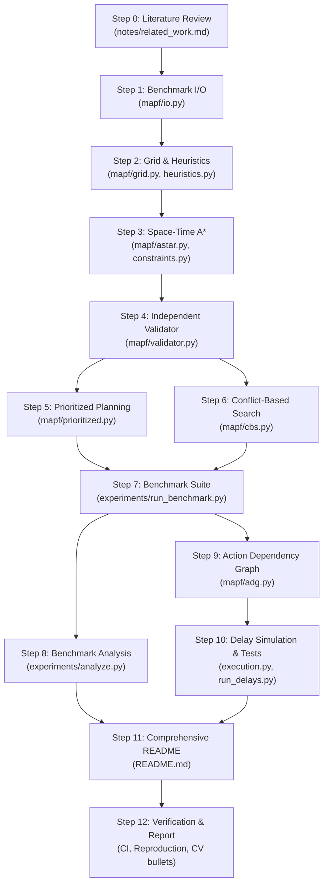

# MAPF-CBS & ADG Delay Robustness: Implementation Plan

**Repository Target:** `koustav286/MAPF-CBS`  
**Target Completion Date:** November 30, 2026  
**Status:** In Progress / Active Planning  

---

## 1. Executive Summary & Project Vision

This project implements a rigorous, reproducible research pipeline for **Multi-Agent Path Finding (MAPF)** and investigates the **execution robustness of optimal vs. prioritized plans under stochastic delays**.

### Core Architecture
- **Part A (Steps 1–8): Classical MAPF Benchmarking**
  - High-performance, pure Python re-implementation of **Conflict-Based Search (CBS)** (Sharon et al., 2015) and **Prioritized Planning (PP)** with space-time $A^*$.
  - Evaluation on Moving AI benchmark grids (`empty-32-32`, `random-32-32-10`, `room-32-32-4`).
  - Independent solution validation ensuring 100% collision-free validity before metric recording.
- **Part B (Steps 9–10): Original Contribution — Delay Robustness Study**
  - Construction of **Action Dependency Graphs (ADG)** (Hönig et al., 2019) to enforce collision-free execution without global clock synchronization.
  - Evaluation of how plans degrade under independent stochastic delay models ($p \in \{0.0, 0.05, 0.1, 0.2, 0.3\}$).
  - Empirical testing of two research hypotheses:
    - **H1:** On instances solved by both algorithms, Sum-of-Costs (SOC) optimal CBS plans suffer greater execution efficiency degradation than PP plans under execution delays.
    - **H2:** Plan degradation positively correlates with cross-agent Action Dependency Graph (Type-2) coupling density.

---

## 2. Project Directory Structure

```
MAPF/
├── .github/
│   └── workflows/
│       └── ci.yml               # Automated test suite execution on push/PR
├── mapf/
│   ├── __init__.py
│   ├── io.py                    # Moving AI .map and .scen parsers
│   ├── grid.py                  # Grid representation and 4-connectivity
│   ├── heuristics.py            # Backward BFS exact distance heuristic cache
│   ├── constraints.py           # Vertex and edge constraint definitions
│   ├── astar.py                 # Low-level space-time A* search
│   ├── validator.py             # Independent solution verifier
│   ├── prioritized.py           # Prioritized Planning (PP) solver
│   ├── cbs.py                   # Conflict-Based Search (CBS) solver
│   ├── adg.py                   # Action Dependency Graph (ADG) builder & metrics
│   └── execution.py             # Discrete-event delay execution simulator & checker
├── experiments/
│   ├── __init__.py
│   ├── run_benchmark.py         # Step 7: Parallel benchmark runner (CBS vs PP)
│   ├── analyze.py               # Step 8: Benchmark analysis & table/figure generation
│   ├── run_delays.py            # Step 10: Monte Carlo delay simulator runner
│   └── analyze_delays.py        # Step 10: Delay analysis, H1 & H2 statistical tests
├── tests/
│   ├── __init__.py
│   ├── test_io.py               # Map/scenario parsing and BFS sanity checks
│   ├── test_grid_heuristics.py  # Grid neighbor tests and BFS heuristic correctness
│   ├── test_astar.py            # Space-time A* with vertex/edge/goal constraints
│   ├── test_validator.py        # Validator correctness on synthetic valid/invalid paths
│   ├── test_prioritized.py      # Prioritized planning tests and reservation table
│   ├── test_cbs.py              # CBS corridor swaps, crossing, and joint A* optimality
│   ├── test_adg.py              # ADG Type-1 and Type-2 edge construction, DAG checks
│   └── test_execution.py        # Delay simulator execution checker and safety verification
├── notes/
│   └── related_work.md          # Step 0: Literature review & framing notes
├── scripts/
│   ├── download_benchmarks.py   # Cross-platform Moving AI benchmark downloader
│   └── download_benchmarks.sh   # Bash benchmark downloader
├── data/                        # Moving AI maps and scens (Git ignored)
├── results/
│   ├── benchmark.csv            # Benchmark metrics (committed)
│   ├── delays.csv               # Delay experiment metrics (committed)
│   ├── summary.md               # Step 8 auto-generated summary tables (committed)
│   ├── delay_summary.md         # Step 10 auto-generated delay summary & tests (committed)
│   ├── plots/                   # Generated PNG plots (committed)
│   └── solutions/               # Validated JSON plan paths (Git ignored)
├── requirements.txt             # Pinned dependencies
├── .gitignore                   # Ignore data/, results/solutions/, caches
├── updatedprompt.md             # Specification reference
└── README.md                    # Reviewer-ready publication report
```

---

## 3. Detailed Step-by-Step Implementation Roadmap



---

### Step 0: Literature Review & Hypothesis Framing
- **Goal:** Contextualize Part B against existing literature on MAPF execution and plan execution dependencies.
- **Key References:**
  - *Hönig et al. (2019):* "Persistent and Robust Execution of MAPF Schedules" (introduces ADGs and Temporal Plan Graphs).
  - *Atzmon et al. (2020):* "Robust Multi-Agent Path Finding" (k-robust MAPF and delay tolerance).
  - *Sharon et al. (2015):* "Conflict-Based Search for Multi-Agent Pathfinding".
  - *Stern et al. (2019):* "Multi-Agent Pathfinding: Definitions, Variants, and Benchmarks".
  - *Zahrádka et al. (2025/2026):* Robust execution monitoring and online replanning.
- **Deliverables:**
  - Create `notes/related_work.md` summarizing existing findings.
  - Clarify hypothesis positioning:
    - If H1 has prior direct evaluation, frame this study as an empirical, independent benchmark replication across standard Moving AI topologies.
    - If unstudied, emphasize novel comparison between optimal CBS and sub-optimal PP under ADG execution.

---

### Step 1: Benchmark Data & Parser Engine (`mapf/io.py`)
- **Coordinate Conventions:**
  - Scenario file format: `bucket, map, width, height, start_x, start_y, goal_x, goal_y, optimal_length`.
  - Moving AI convention: `start_x` = column ($c$), `start_y` = row ($r$).
  - Internal Representation: Always use tuple `(row, col)` / `(y, x)` across all internal grid and state representations.
- **Map File Parsing:**
  - Header: `type octile`, `height H`, `width W`, `map`.
  - Passable terrain: `.` (empty), `G` (ground), `S` (shallow water) $\to$ `True` (cost 1).
  - Obstacles: `@` (wall), `O` (out of bounds), `T` (tree), `W` (deep water) $\to$ `False`.
- **Download Automation:**
  - Download maps (`empty-32-32.map`, `random-32-32-10.map`, `room-32-32-4.map`) and scenario sets (`random` scens 1–10).
- **Sanity Verification:**
  - Implement test verifying that backward/forward BFS shortest path length matches `optimal_length` for scenario entries.

---

### Step 2: Grid & Heuristic Engine (`mapf/grid.py`, `mapf/heuristics.py`)
- **Grid Class:**
  - 4-connected movements: $\Delta r, \Delta c \in \{(-1, 0), (1, 0), (0, -1), (0, 1)\}$, plus wait action $(0, 0)$.
  - Out-of-bounds protection and obstacle checks.
- **Heuristic Cache:**
  - Compute exact shortest path distance using backward BFS starting from the agent's goal position to all reachable grid cells.
  - Cache results in memory indexed by `(map_name, (goal_r, goal_c))`.
  - Ensures admissible and consistent heuristic $h(v) \le \text{dist}(v, \text{goal})$, yielding optimal low-level search expansions.

---

### Step 3: Low-Level Space-Time $A^*$ Search (`mapf/astar.py`, `mapf/constraints.py`)
- **State Representation:**
  - State: `(cell, t)` where `cell = (r, c)` and `t \in \mathbb{N}_0$.
- **Constraint Representation:**
  - **Vertex Constraint:** Agent $i$ cannot occupy cell $u$ at time $t$: `(agent_id, u, t)`.
  - **Edge Constraint:** Agent $i$ cannot traverse edge $u \to v$ arriving at time $t$: `(agent_id, u, v, t)`.
- **Search Dynamics:**
  - Transitions from $(u, t)$ to $(v, t+1)$ where $v \in \text{neighbors}(u) \cup \{u\}$.
  - Valid only if $(v, t+1) \notin \text{vertex\_constraints}$ and $(u, v, t+1) \notin \text{edge\_constraints}$.
  - Cost function: $g = t+1$, $h = \text{heuristic}(v)$, $f = g + h$.
  - Tie-breaking: lower $f$, then lower $h$, then lower $g$.
- **Goal Criteria & Horizon Cap:**
  - An agent reaches its goal at time $T$ if $v = \text{goal}$ and no vertex constraints exist on $\text{goal}$ at any $t \ge T$.
  - Search horizon capped at $T_{\text{max}} = |V_{\text{passable}}| + \max(\{t \mid (\text{goal}, t) \in \text{constraints}\} \cup \{0\})$ to guarantee termination on infeasible constraint sets.
- **Path Cost Definition:**
  - Individual path cost = timestep of goal arrival (excluding trailing waits).
  - Sum of Costs (SOC): $\sum_{i=1}^k \text{cost}(\text{path}_i)$ adhering to Stern et al. (2019).

---

### Step 4: Independent Solution Validator (`mapf/validator.py`)
- **Purpose:** Serve as an immutable truth oracle. Must be implemented and verified before PP and CBS.
- **Validation Pipeline:**
  1. **Endpoint Check:** Path for agent $i$ begins at $\text{start}_i$ at $t=0$ and ends at $\text{goal}_i$.
  2. **Motion Validity:** Every move is a valid 4-neighbor transition or a wait action on a passable cell.
  3. **Temporal Alignment:** Pad all paths by holding final goal positions up to $T_{\text{makespan}} = \max_i |\text{path}_i|-1$.
  4. **Vertex Conflict Check:** For all timesteps $t \in [0, T_{\text{makespan}}]$ and all agent pairs $i \neq j$:
     $$\text{pos}_i(t) \neq \text{pos}_j(t)$$
  5. **Edge / Swap Conflict Check:** For all timesteps $t \in [0, T_{\text{makespan}}-1]$ and all agent pairs $i \neq j$:
     $$\neg \Big( \text{pos}_i(t) = \text{pos}_j(t+1) \;\land\; \text{pos}_j(t) = \text{pos}_i(t+1) \Big)$$
- **Test Matrix:** Unit tests covering valid solutions, collisions, vertex overlaps, edge swaps, and premature goal departures.

---

### Step 5: Prioritized Planning (`mapf/prioritized.py`)
- **Algorithm Flow:**
  - Fixed priority ordering based on scenario input index ($i = 0, 1, \dots, k-1$).
  - Maintain a dynamic space-time `ReservationTable`.
  - For each agent $i$:
    1. Extract constraints from already reserved paths of agents $0 \dots i-1$.
    2. Add permanent reservation for all $t \ge T_j$ at $\text{goal}_j$ for completed agents $j < i$.
    3. Run space-time $A^*$.
    4. If search returns failure, abort instance and return failure (no restarts, preserving deterministic priority baseline).
    5. If search succeeds, add agent $i$'s path to `ReservationTable`.
  - Return joint solution and validate via Step 4.

---

### Step 6: Conflict-Based Search (`mapf/cbs.py`)
- **High-Level Node:**
  - `constraints`: Dictionary mapping `agent_id -> Set[Constraint]`.
  - `paths`: List of paths for each agent.
  - `cost`: Sum of Costs (SOC).
  - `conflicts`: List of detected vertex/edge conflicts.
- **Search Loop:**
  - Priority Queue ordered by `(cost, num_conflicts, node_id)`.
  - Root node: Individual shortest paths without constraints.
  - Pop minimum node $N$:
    1. Detect first conflict $C$ in paths:
       - Vertex Conflict: agents $i, j$ at cell $u$ at time $t$.
       - Edge Conflict: agent $i$ moves $u \to v$ at $t$, agent $j$ moves $v \to u$ at $t$.
    2. If no conflicts found, return $N.\text{paths}$ as the optimal solution.
    3. If conflict $C$ found:
       - Create Child 1: add constraint to agent $i$ ($C_i$). Replan agent $i$. If valid path found, insert Child 1 into Open list.
       - Create Child 2: add constraint to agent $j$ ($C_j$). Replan agent $j$. If valid path found, insert Child 2 into Open list.
- **Resource Constraints:**
  - Hard wall-clock timeout (default 60s, configurable to 30s).
  - Track metrics: `hl_expanded` (high-level expansions), `ll_searches` (low-level searches), `runtime_s`.
- **Optimality & Correctness Tests:**
  - Corridor swap test (forces detour or wait).
  - 4x4 grid joint $A^*$ brute-force solver comparison verifying identical optimal SOC.

---

### Step 7: Benchmark Suite Execution (`experiments/run_benchmark.py`)
- **Benchmark Matrix:**
  - Maps: `empty-32-32`, `random-32-32-10`, `room-32-32-4`.
  - Scenarios: `random-1` through `random-10`.
  - Agent counts: $k \in \{2, 4, 6, 8, \dots\}$ incremented until success rate drops below 10% for both algorithms.
  - Algorithms: CBS and PP.
- **Execution & Storage Protocol:**
  - Parallel multiprocessing with CPU count awareness.
  - Deterministic random seeding and system environment metadata logging.
  - CSV output schema (`results/benchmark.csv`):
    ```
    map,scen,k,algorithm,success,runtime_s,soc,makespan,hl_expanded,ll_searches,timeout_s
    ```
  - JSON solution path serialization (`results/solutions/{map}_{scen}_{k}_{algorithm}.json`):
    ```json
    {
      "map": "empty-32-32",
      "scen": 1,
      "k": 4,
      "algorithm": "cbs",
      "soc": 48,
      "makespan": 14,
      "paths": [
        [[0, 1], [0, 2], [0, 3]],
        [[2, 5], [1, 5], [0, 5]]
      ]
    }
    ```
  - Pilot benchmark run on a small subset (e.g., $k=2, 4$, scenario 1) to measure timing before executing full sweep.

---

### Step 8: Benchmark Analysis Engine (`experiments/analyze.py`)
- **Strict Execution Rule:** Analyzes exclusively from CSV data without re-executing search.
- **Outputs Generated:**
  1. **Success Rate Curves:** Success rate vs. $k$ per map for CBS and PP.
  2. **Runtime Distribution:** Log-scale runtime vs. $k$ showing median and interquartile range (IQR) for solved instances.
  3. **Suboptimality Ratio:** On instances solved by both algorithms:
     $$\text{Suboptimality} = \frac{\text{SOC}_{\text{PP}}}{\text{SOC}_{\text{CBS}}}$$
  4. **Markdown Report:** Automated generation of `results/summary.md`.

---

### Step 9: Action Dependency Graph (ADG) (`mapf/adg.py`)
- **Graph Construction (following Hönig et al., 2019):**
  1. Extract move actions from plan paths, eliminating redundant wait actions.
  2. Action representation: $a_{i, k} = (u, v, t_{\text{planned}})$ where agent $i$ moves $u \to v$ departing at timestep $t$.
  3. **Type-1 Edges (Intra-Agent):** Directed edge $a_{i, k} \to a_{i, k+1}$ ensuring sequential progression.
  4. **Type-2 Edges (Inter-Agent / Spatial Protection):** For agents $i \neq j$, if $\text{start}(a_{i, k}) == \text{end}(a_{j, l})$ and $t_{\text{planned}}(a_{i, k}) \le t_{\text{planned}}(a_{j, l})$, add directed edge:
     $$a_{i, k} \xrightarrow{\text{Type-2}} a_{j, l}$$
     *Physical interpretation:* Agent $j$ cannot move into a cell until agent $i$ has vacated it.
- **Algorithmic Efficiency:**
  - Group actions by cell departure and arrival to compute Type-2 edges in $O(\sum_{\text{cell}} |A_{\text{cell}}|^2)$ instead of pairwise $O(|A|^2)$.
- **Coupling Metrics:**
  - Total Type-2 edges: $E_2$.
  - Total actions: $|A|$.
  - **Type-2 Edge Density:** $\rho_2 = \frac{E_2}{|A|}$.
  - Agent coupling ratio: Fraction of agents involved in at least one Type-2 dependency.
- **Topological Invariant Test:**
  - Assert that ADG is strictly a Directed Acyclic Graph (DAG) for every validated MAPF solution via Kahn's algorithm / topological sort.

---

### Step 10: Delay Robustness Simulator & Statistical Testing (`mapf/execution.py`, `run_delays.py`, `analyze_delays.py`)

#### Simulation Protocol
- Discrete timesteps $T = 0, 1, 2, \dots$
- An agent $i$ is ready to execute action $a_{i, k}$ at time $T$ if and only if all predecessor actions in the ADG have completed.
- **Stochastic Delay Models:**
  - **Per-step Model (Primary):** If agent $i$ is ready to execute an action at timestep $T$, it suffers an execution freeze with probability $p \in \{0.0, 0.05, 0.1, 0.2, 0.3\}$.
  - **Burst Model (Secondary / Cuttable):** With probability $p$, ready agent freezes for duration $D = 5$ timesteps.
- **Safety Oracle:** Execution checker verifies zero vertex conflicts and zero swap conflicts at every simulated timestep $T$.
- **Deadlock Guard:** If no agent executes an action for 1,000 consecutive timesteps, trigger deadlock error.
- **Executed Metrics:**
  - Agent arrival time = timestep when its final action finishes.
  - Executed SOC: $\text{SOC}_{\text{exec}}(p) = \sum_{i=1}^k \text{arrival}_i(p)$.
  - **Degradation Metric:**
    $$\text{Degradation}(p) = \frac{\text{SOC}_{\text{exec}}(p)}{\text{SOC}_{\text{exec}}(p=0)} - 1$$
    *(Normalized against $p=0$ execution rather than planned SOC to account for wait elimination).*
  - Replication: $R = 30$ Monte Carlo seeds per paired instance and probability level $p$.

#### Statistical Hypothesis Evaluation
- **H1 Evaluation:**
  - Paired Wilcoxon signed-rank test comparing mean degradation of CBS vs. PP on matched instances for each $p \in \{0.05, 0.1, 0.2, 0.3\}$.
  - Report median paired difference and two-sided p-value.
- **H2 Evaluation:**
  - Spearman rank correlation $r_s$ between Type-2 density $\rho_2$ and degradation at $p = 0.1$.
  - Controlled correlation with agent count $k$ to verify whether coupling density provides predictive signal beyond raw agent crowding.
- **Automated Summary:** Output generated directly to `results/delay_summary.md`.

---

### Step 11: Repository Documentation & Presentation (`README.md`)
- High-standard scientific documentation:
  1. **MAPF Problem Formulation:** Formal objective, vertex/edge conflict definitions.
  2. **Algorithm Descriptions:** Space-Time $A^*$, Prioritized Planning, CBS with pseudocode. Explicit attribution as standard re-implementations.
  3. **ADG Delay Robustness Study:** Theoretical motivation, ADG formation, delay simulation methodology, hypothesis statements.
  4. **Reproduction Guide:** Step-by-step CLI instructions (`download`, `test`, `benchmark`, `delays`, `analyze`).
  5. **Empirical Results:** Embedded figures and Markdown tables from `results/summary.md` and `results/delay_summary.md`.
  6. **Limitations & Practical Considerations:** Python runtime bounds, fixed PP priority order, absence of CBS bypass/disjoint splitting, kinematic abstractions, synthetic delay assumptions.
  7. **Real-world Context:** Connection to execution controllers (e.g., Robot Conga tracking error absorption).
  8. **Complete Academic Citations.**

---

### Step 12: Continuous Integration, Reproducibility & Final Report
- **CI Suite:** `.github/workflows/ci.yml` running `pytest` across Python 3.10, 3.11, 3.12, 3.13, 3.14.
- **Clean Clone Verification:** Verification script validating end-to-end execution from fresh repository clone.
- **CV Metric Summary Generator:** Script generating exact metrics for CV bullet points:
  - Total maps evaluated and benchmark execution time.
  - Maximum agents solved at $\ge 50\%$ success threshold for CBS and PP.
  - Overall CBS vs. PP success rate and suboptimality ratio.
  - H1 Wilcoxon signed-rank test results and p-values.
  - H2 Spearman correlation coefficients ($\rho_2$ vs. degradation and $k$ vs. degradation).

---

## 4. Contingency & Cut-List Hierarchy

If execution falls behind schedule, apply cutbacks strictly in the following priority order:
1. **Drop animation GIF generation:** Eliminate visualization exports.
2. **Drop burst delay model:** Restrict experiments strictly to the per-step delay model.
3. **Reduce scenario files:** Evaluate scenarios 1–5 instead of 1–10.
4. **Drop room map:** Restrict experiments to `empty-32-32` and `random-32-32-10`.
5. **Reduce time limit:** Lower search timeout from 60 s to 30 s.

> **Absolute Invariant:** Under no circumstances will tests, the independent solution validator, or the execution checker be modified, skipped, or compromised.

---

## 5. Development Schedule & Milestone Tracker

| Phase | Target Date | Step / Objective | Deliverables / Verification Criteria | Status |
|:---|:---|:---|:---|:---:|
| **Phase 0** | Nov 18 | Step 0 & Step 1 | `notes/related_work.md`, benchmark data, `mapf/io.py`, parsing unit tests | ⬜ Pending |
| **Phase 1** | Nov 18 | Step 2 & Step 3 | `mapf/grid.py`, `heuristics.py`, `astar.py`, `constraints.py`, low-level tests | ⬜ Pending |
| **Phase 2** | Nov 19 | Step 4 & Step 5 | `mapf/validator.py`, `mapf/prioritized.py`, PP baseline integration tests | ⬜ Pending |
| **Phase 3** | Nov 20–21 | Step 6 | `mapf/cbs.py`, Joint $A^*$ optimality validation test, CBS unit tests | ⬜ Pending |
| **Phase 4** | Nov 22–23 | Step 7 & Step 8 | Pilot benchmark, full benchmark runs, `results/benchmark.csv`, `analyze.py` | ⬜ Pending |
| **Phase 5** | Nov 24–25 | Step 9 & Step 10 | `mapf/adg.py`, `execution.py`, Monte Carlo delay runs, `results/delays.csv` | ⬜ Pending |
| **Phase 6** | Nov 26 | Step 10 Analysis | `analyze_delays.py`, H1 & H2 hypothesis tests, `results/delay_summary.md` | ⬜ Pending |
| **Phase 7** | Nov 27–28 | Step 11 | Complete `README.md` with embedded plots, analysis tables, and citations | ⬜ Pending |
| **Phase 8** | Nov 29–30 | Step 12 | CI workflow, clean reproduction check, CV bullet metrics generation | ⬜ Pending |
